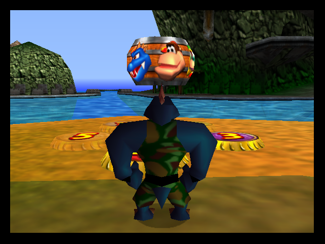
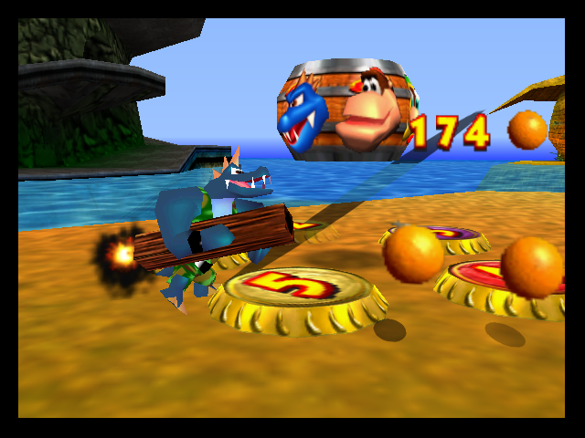
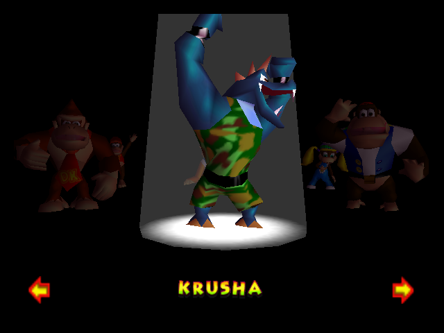
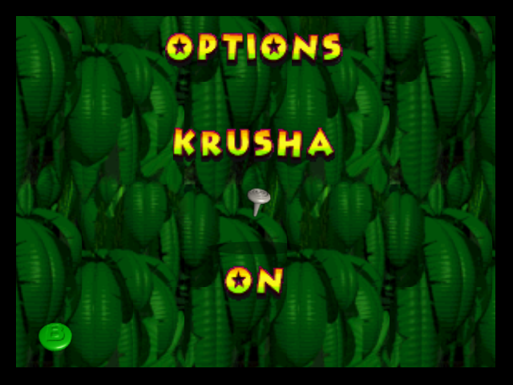
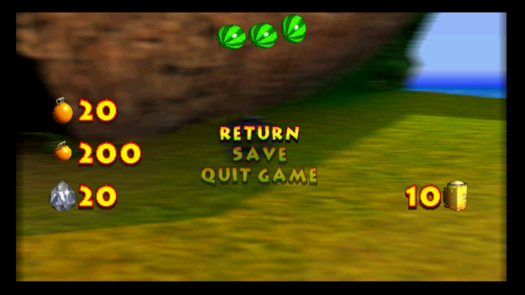

# Donkey Kong 64 — Krusha + Tag Anywhere

**Krusha as a sixth adventure character, built on Isotarge’s Tag Anywhere.**

Play as Krusha alongside the five original Kongs: swap with the D-pad, select
him in tag barrels, fire his bazooka, and clear nearby enemies with a powerful
shout. Krusha is available from the start, with a persistent option to turn him
off. The current checkpoint is **v0.4.2**.



## What this hack adds

- **A sixth character.** The rotation is DK → Diddy → Lanky → Tiny → Chunky →
  Krusha → DK. Krusha needs no unlock event, even with Speed Mode off. The other
  Kongs retain their normal unlock requirements in that mode.
- **A working bazooka.** Krusha starts unarmed, equips and holsters his native
  weapon, fires using shared standard ammunition, and supports first-person
  aiming. His visible weapon follows the equipped state, including camera exits.
- **Six-character tag barrels.** Krusha has his own waiting and selected
  animations. His exterior face sits between Chunky and DK, using the custom
  portrait selected and adjusted for this project. The barrel is enlarged by
  15% to accommodate the extra face while keeping it close to the vanilla design.
- **Adventure interactions.** Krusha can run, jump, climb trees, swing on vines,
  swim, throw oranges, use numbered bananaports, and lift/carry/drop/throw boulders.
  He can enter and leave Cranky’s, Funky’s, and Candy’s shops safely.
- **A vocal instrument move.** His shout uses part of his charged-attack burp
  animation and the supplied scream recording, with native instrument enemy
  damage, a darkened background, spotlight, centered zoom, a full camera orbit,
  and camera shake. It costs one displayed crystal from the shared supply.
- **A persistent KRUSHA switch.** Turning it off restores the five-character
  tagging cycle and original five-character barrels, including their exterior.
- **Consistent presentation.** Krusha is 10% larger, with adjustments for
  adventure, tag-barrel previews, and shop scenes. The startup lineup includes
  his gray silhouette, and the credit reads “Krusha patched in by Arthan.”
- **Widescreen corrections.** The existing Widescreen option also corrects HUD,
  menu and pause sprites, moves the adventure HUD toward the edges, and fixes
  stretched instrument and tag-barrel presentations, including barrel entry.
  Standard-mode placement is preserved.

| Bazooka in adventure | Krusha in the tag barrel |
| --- | --- |
|  |  |

## Playing

Patch downloads are published through [GitHub Releases](https://github.com/AuryArthan/DK64-TagAnywhere-Krusha-code/releases).
The [release workflow notes](release-assets/README.md) explain publication on push.

Apply this project’s **BPS patch to a clean, original Donkey Kong 64 USA ROM**
in big-endian `.z64` format. The patch already includes Tag Anywhere; start from
the original game rather than applying it over another hack.

Expected source SHA-1:

```text
CF806FF2603640A748FCA5026DED28802F1F4A50
```

European and Japanese ROMs are not supported. ROM files are not included here.

Configure the emulator or flashcart for **8 MB Expansion Pak memory** and
**EEPROM 16K saves**. Set the game’s Widescreen option ON when displaying the
output at 16:9; use Standard for 4:3. Black overscan borders are left intact in
the ROM and can be handled by the emulator’s display settings if desired.

| Action | N64 control |
| --- | --- |
| Tag backward | D-pad Left |
| Tag forward | D-pad Right or L |
| Rotate the tag-barrel selector | Control Stick Left/Right |
| Select and leave the tag barrel | A, B, or Z |
| Equip / holster bazooka | Z + C-Left |
| Fire the equipped bazooka | B |
| First-person aim with bazooka equipped | C-Up |
| Fairy camera while unarmed, after the shared camera unlock | Z + C-Down |
| Shout while unarmed | Z + C-Up |
| Throw an orange | Z + C-Right |

Tagging is deliberately blocked during unsafe actions, cutscenes, and certain
maps. A denied sound indicates that the current situation does not allow a tag.
Drop or throw a carried boulder before switching characters.

### Options and the Tag Anywhere baseline

In the title menu’s **Options** barrel, move left/right to **KRUSHA**, then
up/down to turn it ON or OFF. It defaults to ON for existing saves and persists
through resets. Speed Mode is a separate option in the same menu.



The baseline’s **Speed Mode OFF** follows normal progression for the original
Kongs and their moves; Krusha remains available. **Speed Mode ON** unlocks the
original Kongs and moves, completes training, starts in DK Isles, skips much
introductory text and several celebrations, and shortens selected cutscenes and
turn-ins. The baseline also unlocks Mystery menu options. This project retains
Tag Anywhere’s safeguards around dangerous character changes.

## Current limitations

Krusha is an extra way to explore and fight, with progression still handled by
the original Kongs:

- **He cannot collect pickups yet**, including colored bananas, coins and shared
  consumables. Switch to an original Kong to collect them and replenish supplies.
  There is no sixth set of collectibles or dedicated shop upgrades.
- His fairy camera can enter photo mode and take pictures, consuming film, but
  does not award fairy capture flags or rewards.
- His shout defeats nearby vulnerable enemies, but does not perform the five
  Kongs’ instrument-pad puzzle songs. It uses crystals rather than instrument energy.
- Shop visits are safe, but Krusha receives the “nothing for sale” response.
  Boulders are supported; this does not grant every Chunky-only ability.
- Multiplayer, every boss/minigame, and a complete 101% playthrough have not been
  exhaustively validated. This is not a guarantee that every encounter works.

**Original N64 hardware remains untested.** v0.4.1 added 16 KiB ROM padding for
flashcart loader transfers, and v0.4.2 retains that alignment and valid CIC-6105
checksums. These are compatibility preparations, not console certification.

Native EEPROM saves can be carried between these builds with the appropriate
emulator profile setup. Save states belong to the exact ROM that created them;
keep older states with their corresponding ROM and cold-boot a new build first.

## Widescreen

The corrections follow the game’s existing setting. They include ordinary HUD
icons and counters, pause inventory sprites, and special instrument/barrel
camera paths. They do not require a separate widescreen ROM.



## Development and validation

The latest fix addresses the inherited **tree-tag origin warp**. A native
character swap rebuilds the model before a tree/vine grab can read its new
transforms. v0.4.2 uses the existing regrab cooldown for one update after a swap,
allowing initialization to finish without disabling ordinary airborne tagging.

The exact v0.4.2 ROM passed **723 focused assertions**, including nine original
reproduction timings, 112 tree approaches, 44 ordinary airborne tags, eight vine
cases, and regression checks for gameplay, weapons, shops, barrels and options.
Those counts include controller-driven scenarios with logged position/loading
fixtures; they are not a measure of campaign completion. No crashes or new
regressions were observed in the accepted checks. Earlier v0.4.1 release QA
identified the tree-tag bug that prompted this fix.

The [checkpoint history](docs/CHANGELOG.md) summarizes the development milestones.
For implementation details, see:

- [Tree-tag fix and validation](docs/tree-tag-fix.md)
- [Shout animation, sound and camera development](docs/krusha-roar.md)
- [Krusha size adjustments](docs/krusha-size.md)
- [Barrel portraits and startup lineup](docs/krusha-barrel-portraits.md)
- [Widescreen rendering changes](docs/widescreen.md)
- [Console packaging and its limits](docs/console-packaging.md)
- [Building from source](docs/BUILDING.md)
- [AI/session handoff and project knowledge](codex_handoff/README.md)

The detailed development documents retain the history of experiments and tuning;
the behavior described above is the current version. Maintained build, play and regression helpers are in [tools/](tools/README.md).
Large emulator profiles, raw test captures and downloaded binaries remain local.
The screenshots used here are copied into the repository so they display on GitHub.

## Credits

**Krusha patched in by Arthan.** Concept, direction, playtesting, supplied scream
recording, and portrait selection/adjustments by Arthan. Implementation and
regression testing developed with Codex; the custom portrait uses AI-assisted
artwork selected and adjusted by Arthan.

Built on **[Donkey Kong 64 — Tag Anywhere by Isotarge](https://github.com/Isotarge/dk64-tag-anywhere)**,
using the local baseline commit `e9ca72f5070c7e4bad69d37382c5a0798b06462f`.
Thanks to Isotarge and the original project’s contributors; their full credits
remain available in the upstream project and Git history. The partial DK64
decompilation and reverse-engineering work provided useful implementation references.

Donkey Kong 64, its characters, and the original game assets are by Nintendo/Rare.
