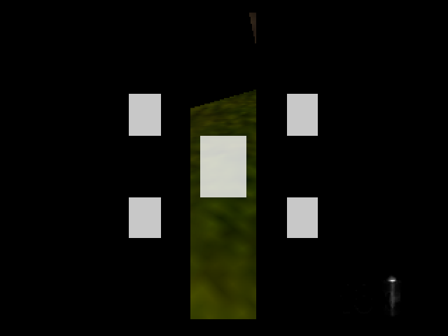
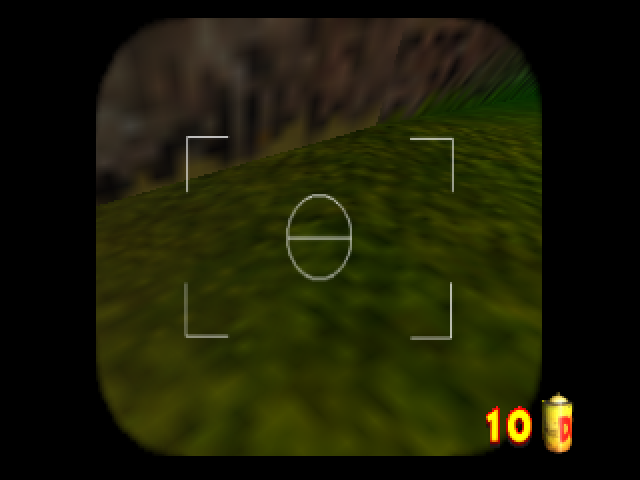
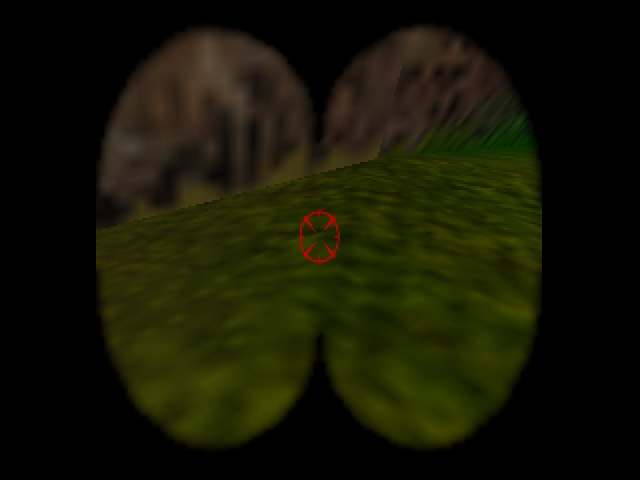
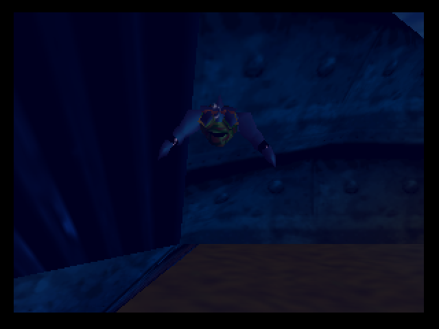
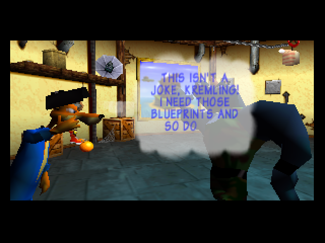
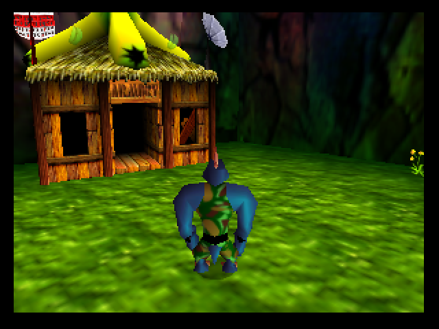

# v0.5 emulator compatibility and interaction fixes

These changes are included in **v0.5**. The older v0.4.2 patch does not contain
them. The tested v0.5 ROM is USA-only, 34,701,312 bytes, SHA-256:

```text
98e0b5cc3a0b5e9067ce0595e57217518e248822056a31d01ccceaac18da535a
```

## Recommended settings

For v0.5, use **Mupen64Plus-Next + GLideN64**, with framebuffer
emulation enabled, **CountPerOp = 1** and **8 MB Expansion Pak memory**.
Use the game's **Screen Size → Widescreen** option for a 16:9 display, with
external stretching to 16:9. Leave the emulator's separate widescreen hack off.
The ROM provides its own world, HUD and sprite corrections.

Batocera's **Graphics API: Auto** and its **RDP plugin** are different settings.
Its current configuration generator chooses **OpenGL Core** for this core and
sets the RDP default to **GLideN64**. This conclusion comes from Batocera's
[backend selection](https://github.com/batocera-linux/batocera.linux/blob/master/python-src/batocera-launch-libretro/batocera_launch_libretro/emulator.py),
[GL Core override](https://github.com/batocera-linux/batocera.linux/blob/master/python-src/batocera-launch-libretro/batocera_launch_libretro/mixins/gl_mixins.py)
and [Mupen64Plus-Next defaults](https://github.com/batocera-linux/batocera.linux/blob/master/python-src/batocera-launch-libretro/batocera_launch_libretro/cores/mupen64plus_next.py),
checked 2026-10-31. The user's Batocera version/hardware was unspecified;
explicitly selecting GLideN64 removes ambiguity about the RDP plugin.
See also the [Batocera N64 guide](https://wiki.batocera.org/systems:n64) and
[official libretro core documentation](https://docs.libretro.com/library/mupen64plus/).

The repository's standalone Mupen64Plus 2.5.9 / Glide64mk2 launcher is another
tested option and explicitly configures the ROM's save size and CPU timing.
ParaLLEl-RDP and Angrylion have not been validated for v0.5.
Original N64 hardware remains untested.

## What changed

| Reported issue | Implementation and observed behavior |
| --- | --- |
| Fairy camera obstruction | The widescreen mask's cycle/render-mode commands used old SDK bitfield encoding with F3DEX2 opcodes. Emit the native F3DEX2 words. The lens, reticle, film counter and photo shutter render correctly under GLideN64. |
| Upgraded weapon scope obstruction | The same mask correction fixes the scope. Native aiming, firing and exits remain active. |
| Underwater tint split | Keep the native water renderer's color, depth-dependent alpha and smoothing, but give its coverage quad an uncompressed projection. HUD/sprite correction stays enabled. |
| Health and ammo pickups | Allow the requested shared resources through native pickup eligibility. Crates spill five separate ammo props, so those must also be allowed. A crate refills bazooka ammunition; grenade oranges use their separate counter. |
| Crown arenas | Extend the crown pad's Chunky standing-on-pad script predicate to also test actor 7. Preserve native contact/button checks and the character's real identity. Allow the shared crown reward. |
| Snide's wording | Substitute the whole word `KONG` with `KREMLING` in his dialogue only for Krusha. Native wrapping/glyph allocation handles the longer word. Original Kongs keep their text. |
| Chunky boulder tags | Apply the existing heavy-action tag guard to both Chunky and Krusha. Tags resume after dropping/throwing. |

Colored bananas, coins and other Kong-specific progression still cannot be
collected by Krusha. Crystal/film pickups and homing-ammo crates were not added.
No global Chunky-ID spoof or blanket permission for all progression items is used.
The ordinary native arena rules, enemy behavior and timer remain intact.
Read-only inspection confirmed the same standing-on-pad pattern in all nine
static crown-pad scripts, including the Chunky-only pad; runtime victory testing
was performed in Japes.

## Camera comparison

These are unmodified test captures. Widescreen captures are 4:3 framebuffers
intended for external 16:9 stretching, as when playing the game.

| v0.4.2 camera in Widescreen | Corrected v0.5 build |
| --- | --- |
|  |  |

| Corrected upgraded scope | Full-width underwater tint |
| --- | --- |
|  |  |

| Snide addresses Krusha | After the Japes crown reward |
| --- | --- |
|  |  |

## Save-size detection

An additional compatibility issue appeared during setup: Mupen64Plus-Next did
not recognize the modified ROM's hash and defaulted to **4-Kbit EEPROM**, whereas
DK64 requires **16 Kbit (2048 bytes)**. This prevented the complete native save
fixture, including Speed Mode, from loading correctly.

The build now writes the standard Advanced Homebrew ROM Header's `ED` marker
at offsets `0x3C–0x3D` and save type `2` in the high nibble of `0x3F`. The USA
country byte, IPL3, code, asset offsets, native save format and 16 KiB ROM padding
are preserved. Header CRCs are still computed normally. The core's own
[ROM loader](https://github.com/libretro/mupen64plus-libretro-nx/blob/develop/mupen64plus-core/src/main/rom.c)
explicitly supports this metadata; its log changes from save type 0 to 1, and
the native Speed Mode fixture now loads without changing ROM database entries.
Older emulators/loaders may still require an explicit EEPROM 16K setting.
This metadata is not a claim of physical-console testing.

Back up saves before changing builds. Native EEPROM data can be transferred,
but emulators may name it using the ROM's MD5 or filename. Libretro `.srm` files
contain more than just the EEPROM: do not rename a raw 2048-byte `.eep` to `.srm`.
Do not use an old-ROM savestate to validate this build.

## Validation

The requested core was run locally on Linux through RetroArch 1.18.0, with
GLideN64 and software OpenGL (Mesa llvmpipe), at native 320×240 rendering.
The official core reports version `3.0-Vulkan 15bada8`; its ELF SHA-256 is
`26f2b4ec722558d77bc9e1582e62ab80c84190bb20dfadc48a148e6210c8775e`.
A test-only libretro input proxy supplied controller input; emulation and
rendering used the official core. This was not a Batocera installation test.

The final ROM passed 23 graphics/control checks: Krusha and DK cameras, photos,
exits, DK's upgraded scope/firing in Standard and Widescreen, plus underwater
movement and tint captures. It also passed 26 interaction checks: health/ammo/
grenades, colored collectible exclusions, Chunky carrying/tag restrictions,
Krusha-versus-DK Snide text, native Japes crown entry, combat, the earned crown
flag, return, completed celebration and resumed movement.

Position/loading-zone and resource fixtures were logged in isolated profiles.
Battle victory used ordinary punch/jump inputs and the native timer/reward;
no character ID, action, enemy deletion or crown-flag writes forced it.
The graphics run cold-booted the final ROM and used native menu options; later
interaction checks loaded only its own exact-build state. Initial harness timing
and textbox-diagnostic errors were corrected and rerun; they were not ROM fixes.

A second GLideN64 run with **ThreadedRenderer = True** passed another 18
camera/scope/water checks, matching Batocera's threaded-rendering default.
A separate native-save test passed 14 checks: automatic 16-Kbit EEPROM selection,
loading the Speed Mode fixture, native Krusha OFF storage, complete frontend
shutdown/restart, preserved OFF and Speed Mode values, restoring ON, and an
unchanged source EEPROM fixture. No savestates or option RAM writes were used
in that persistence test. These add up to **81 libretro checks** on this ROM.

The existing standalone Mupen64Plus 2.5.9 / Glide64mk2 suite also passed all
**140 assertions**: core34, fairy-photo/locked-character extras10, barrel11,
weapons/armed-barrel20, extended barrel selections36, and native options29.
Its shared-orange expectation was updated to the user's requested new behavior.
Combined with the 81 libretro checks, this final ROM passed **221 assertions**
([machine-readable summary](qa/mupen64plus-next-fixes.json)).
The prior v0.4.2's723 tree/vine/regression assertions belong to that earlier
ROM and are not added to this total. No crashes were observed in these runs.

Raw local evidence (ignored, not shipped) is under `runtime/libretro-investigation/`:
`verified-final-profile/logs/`, `verified-threaded-profile/logs/`,
`save-persistence-profile/logs/`, their screenshots, and `baseline-v042/` for the
original corruption. The standalone suite is at `runtime/qa/mupen-next-fixes-20261031/`.
Test helpers are tracked in `tools/`; see their README.
These checks do not certify every crown arena, every map/cutscene, a complete
campaign, all renderers/devices, or original hardware.
