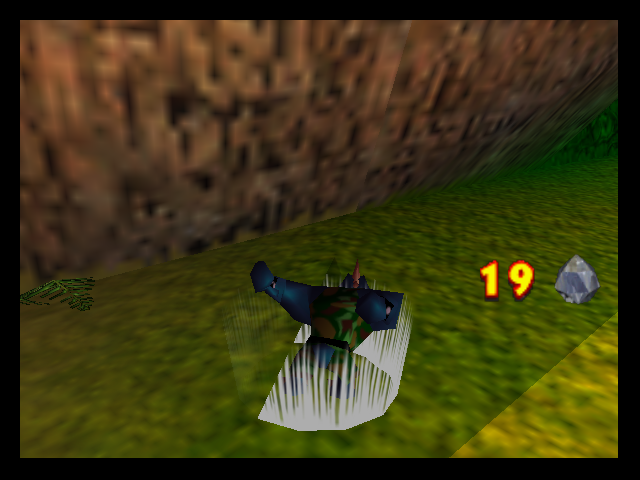
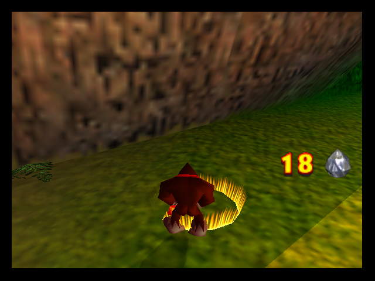

# Krusha's identity color

Development after v0.6, 2026-11-01. The approved startup silhouette in
`bin/Nintendo_Krusha.png` supplies **RGB 173,173,173 (`#ADADAD`)**. This means
Krusha's identifying effect color; his skin, portrait and clothing retain their
approved artwork.

## Charged B attack

The expanding shockwave released after holding B now uses gray instead of
falling through to Donkey Kong's yellow effect. All six texture frames use the
same gray, retaining every native alpha byte, including the radial transparency
and animated fade. Geometry, expansion, damage, crystal cost and move timing
remain native. This is separate from the Z+C-Up shout.

`src/krusha_colors.c` replaces the spawnActor call at `80684744` inside the
native shockwave spawner (`806846B4`). The parent is still in `a2` at this call.
Only the adventure player's actor 7 with KRUSHA ON receives model `0xED`.
The original spawner continues to initialize and run the effect normally.

Native actor model numbers are **one-based**: yellow model `0xAD` uses table 5
file `0xAC`. The native table has 236 files, so the new model `0xED` requests
file `0xEC`; `krushaBarrelFile` redirects that reserved request to table 27,
file 3 **before** native table lookup. A separate model-cache key avoids
changing DK's or an enemy's ring when effects coexist. No character ID spoof,
native table extension or existing model/texture replacement is involved.

`build/character_colors.py` samples the silhouette's main gray and creates the
payloads in memory. Table 27 now holds:

| Index | Asset |
| --- | --- |
| 0 | Existing six-face barrel model |
| 1–2 | Existing approved barrel portrait halves (texture IDs 7001–7002) |
| 3 | Gray shockwave model |
| 4–9 | Six RGBA32 shockwave frames (texture IDs 7003–7008) |

The barrel and portrait payload bytes are unchanged. The source models for all
five original rings and their textures also remain unchanged. The startup PNG
is sampled, never edited by this build step.

| Krusha: gray | DK: original yellow |
| --- | --- |
|  |  |

## Other colors investigated

This audit used the local partial decompilation, USA machine code, the existing
hack and relevant rendering code in the recompilation reference. It is a
targeted adventure audit, not proof that every unused or multiplayer effect in
the ROM has been enumerated.

| Context | Finding / decision |
| --- | --- |
| Charged B shockwave | Actual character color: DK yellow, Diddy red, Lanky blue, Tiny purple, Chunky green. Krusha now has gray. |
| Startup head lineup | Already uses the approved gray; unchanged. |
| Charged B charging sparks (`80684900`) | Shared sprite and randomized particle parameters, with no Kong-color branch. Keep native common sparks. |
| Ground-pound shockwaves (`80685708`) | Color/model selected by slam upgrade level, not character. Keep the level colors. |
| Impact stars and particle bursts (`806874EC`, `80684A00`) | Shared/cycling star sprites, not a Kong identity palette. Keep their colors. |
| Shout/instrument stage | Common spotlight/background lighting. No character-color palette to correct; preserve the accepted presentation. |
| Colored bananas, balloons, coins, blueprints and their HUD/pause rows | Original-five ownership colors. Krusha has no colored collectible set; leave those colors and exclusions intact. No gray collectible set or sixth inventory row was added. |
| Ammo/oranges, melons, crystals, film, keys and crowns | Item/weapon colors convey the object or supply type. Keep native colors. |
| Tag-barrel portrait and character models | Character artwork rather than an identity tint; preserve the approved blue Krusha face and models. |
| Tag-barrel name text | Common yellow/red font for the Kongs and Krusha, not a per-character color. Preserve the shared UI style. |
| Damage/invincibility flashes and map lighting | Time/world-driven colors, not character identity. Preserve them. |
| Multiplayer costume/team coloring | Separate native multiplayer system. The adventure-only ring change does not alter it. |

The original-five UI color tables found at `8075054C` and menu `800337DC`
do not constitute a generic six-character effect palette. Overwriting a DK
entry or indexing a sixth entry would recolor original content or read outside
the table. No additional incorrect Krusha identity-color fallback was found in
the audited adventure paths.

## Validation

Final ROM SHA256:
`437d3de4f9679763df9293518cda6c31c4d4321bb32c61566eb02faeb64f6532`.
All **121 gameplay assertions** and **28 asset assertions** passed:

| Completed check | Assertions |
| --- | ---: |
| Standalone Mupen64Plus/Glide64mk2 core gameplay | 34 |
| Standalone rings: all six characters, repeated switching, both aspect modes | 41 |
| Mupen64Plus-Next/GLideN64 rings: Krusha/DK/Krusha, both aspect modes | 17 |
| Native Krusha option persistence and five/six-character barrels | 29 |
| Asset bytes, alpha planes and original-content preservation | 28 |

A separate rebuild matched every ROM byte. CIC-6105 checksums, 16 KiB alignment,
EEPROM metadata and BPS round-trip validation passed. No crashes were observed
in these checks; this is not a full campaign or physical-console certification.
The raw reports are isolated under `runtime/qa/character-colors-20261101/`;
the public QA summary records only the completed final-build runs. Earlier
probes and the initial insufficient Next frame-step budget are not counted.

Use `tools/check-character-colors.py` to check the actual built asset bytes,
including all six alpha planes and preservation of the original-five assets.
`tools/krusha-colors-test.py` exercises real held/released B input, the resident
native model-cache key, expansion/lifetime, cleanup, cost and restored control.
It alternates Krusha/DK/Krusha, covers the other four Kongs, and checks Standard
and Widescreen. See the [QA summary](qa/krusha-character-colors-20261101.json) for the completed runs and
their exact ROM hash. Historical v0.6 evidence does not validate this build.

The v0.6 tag and downloadable patch are preserved. This is an unversioned
development change until the user requests another checkpoint/release.
